# Editor web (`envs edit --ui`)

Interfaz web local para editar `values.yml`. Este documento recorre cada acción con una captura de pantalla de la aplicación. Para el resumen de comandos, consulta el [README](../README.md); para el historial en detalle, [history.md](history.md).

Las capturas usan un proyecto de ejemplo con tres worktrees (`main`, `feature-checkout` y `fix-login`) y las variables `DATABASE_URL`, `PORT`, `LOG_LEVEL`, `DEBUG` y `FEATURE_CHECKOUT`.

## Iniciar

```sh
envs edit --ui
```

Ejecuta `init` (si hace falta) y `pull`, y levanta un servidor en `127.0.0.1` con un puerto aleatorio. Abre la dirección que se imprime (se intenta abrir el navegador por ti). Detén el servidor con Ctrl+C.

## 1. Vista general

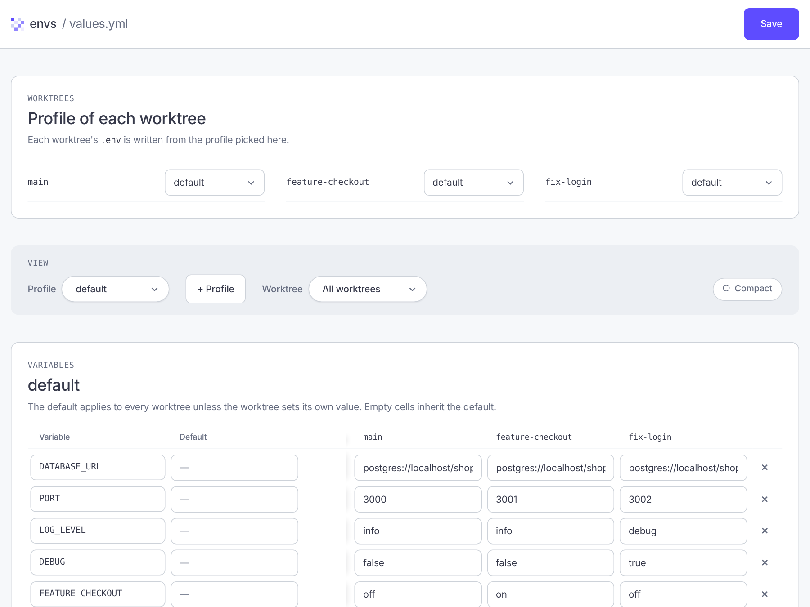

- **Encabezado:** el estado (por ejemplo *Unsaved changes*), el botón **History** y **Save**. **History** lleva al panel del historial, que está al final de la página, y muestra cuántos puntos hay; el foco pasa al título del panel. Con el historial desactivado, el botón sigue ahí y el panel lo explica.
- **Worktrees:** el perfil de cada worktree.
- **View:** el perfil y el worktree que se muestran, y el modo compacto.
- **Variables:** una tabla con una columna de valor por defecto y una columna por worktree.
- **History:** el panel del historial (ver más abajo).

## 2. Editar un valor

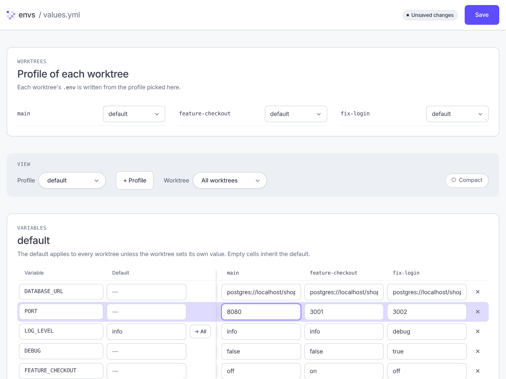

Escribe en cualquier celda. Una celda vacía hereda el valor por defecto. En el ejemplo, `PORT` de `main` pasó de `3000` a `8080`. Mientras haya cambios sin guardar, el encabezado muestra **Unsaved changes**.

## 3. Aplicar un valor por defecto a todos los worktrees

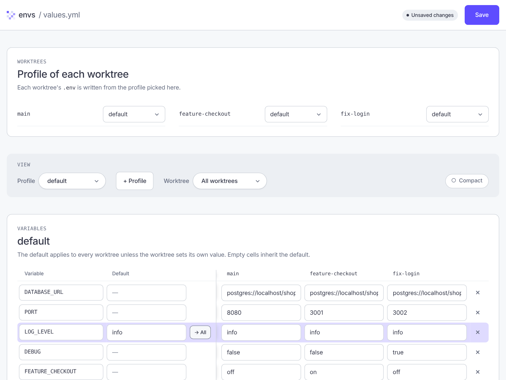

Con un valor por defecto escrito, el botón **→ All** copia ese valor a la celda de cada worktree.

## 4. Perfiles

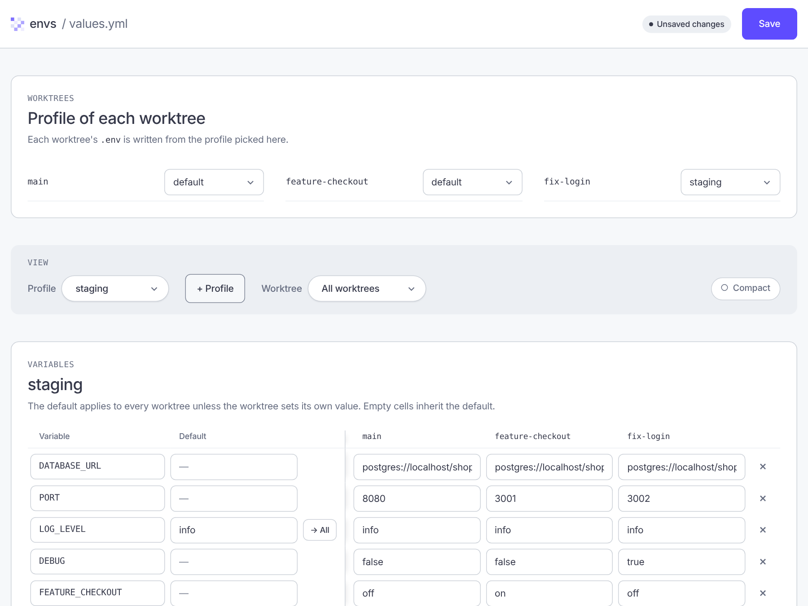

- **+ Profile** pide un nombre y crea un perfil nuevo como copia de `default`.
- En **Profile of each worktree** eliges qué perfil usa cada worktree. En el ejemplo, `fix-login` usa `staging`.
- El selector **Profile** de la sección *View* cambia el perfil que se edita en la tabla.

## 5. Filtrar por worktree

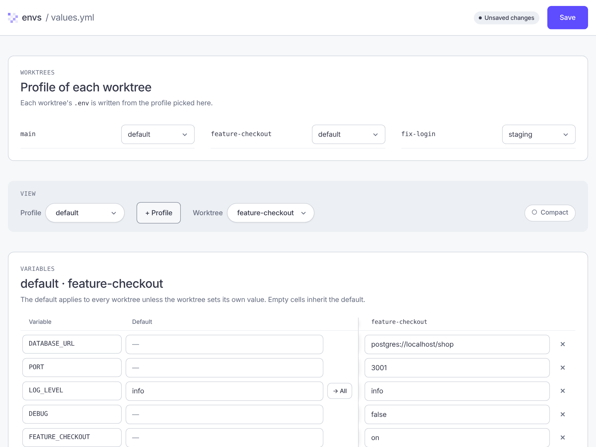

El selector **Worktree** deja en la tabla solo la columna de un worktree.

## 6. Modo compacto

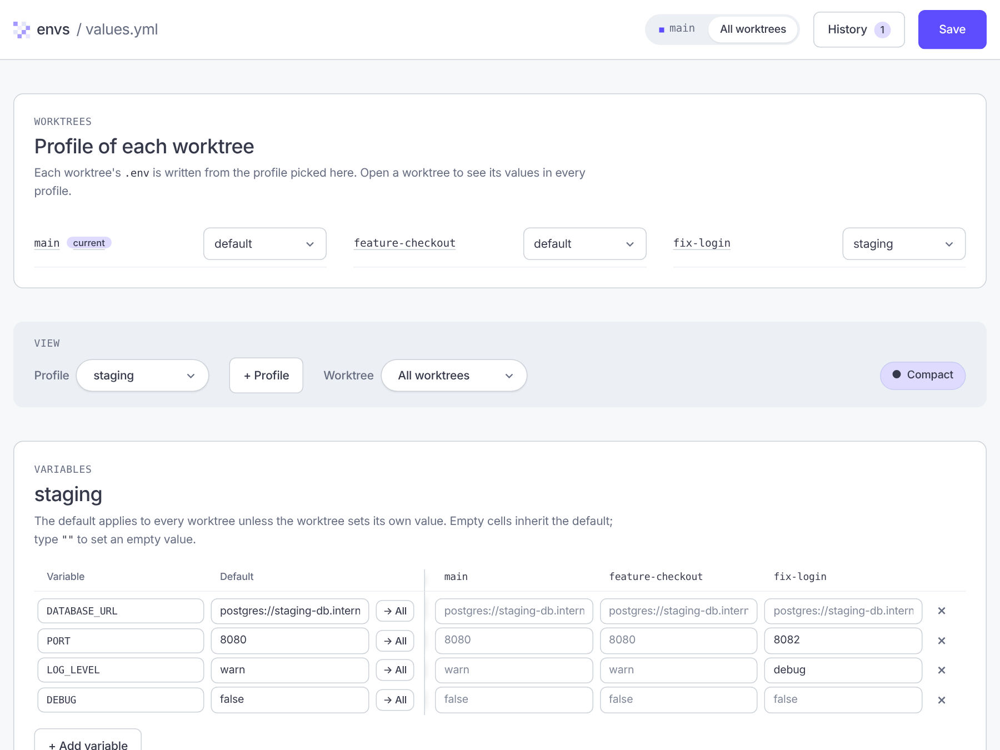

**Compact** reduce el alto de las filas, útil con muchos worktrees o variables.

## 7. Guardar

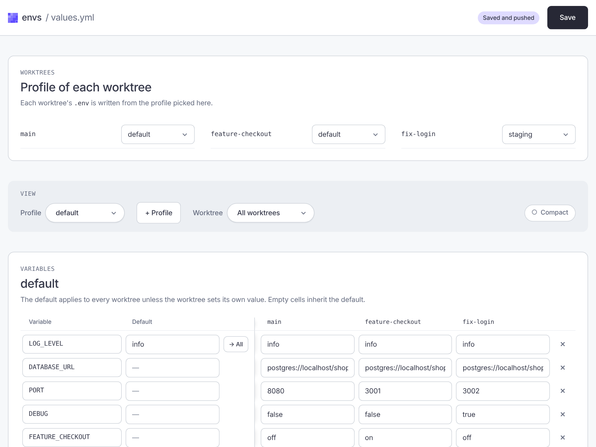

**Save** (o Ctrl/Cmd+S) escribe `values.yml`, agrega un punto al historial y ejecuta `push` sobre los `.env`. El encabezado muestra **Saved and pushed** y, debajo de la página, el registro del `push`.

Los números y booleanos conservan su tipo: guardar `3000` sin tocarlo no genera un cambio.

## Historial

El panel **History** lista los puntos de `.envs/history.ndjson`, del más nuevo al más antiguo, con su hash corto, fecha y número de cambios. Las etiquetas indican el punto `latest`, el `initial`, el que coincide con lo que hay en el editor (`in editor`) y los puntos de resincronización (`external`).

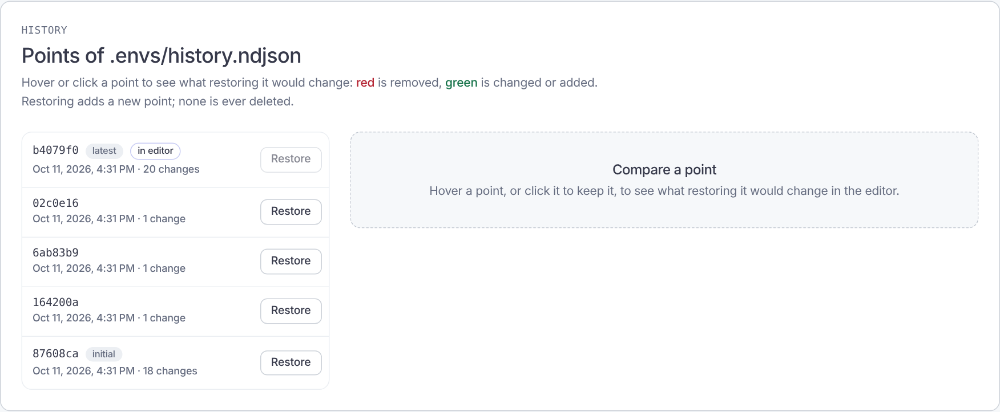

### 8. Ver los cambios de un punto

Pasa el cursor por un punto para ver la diferencia entre el estado de ese punto y lo que hay **ahora en el editor**, incluidos los cambios sin guardar.

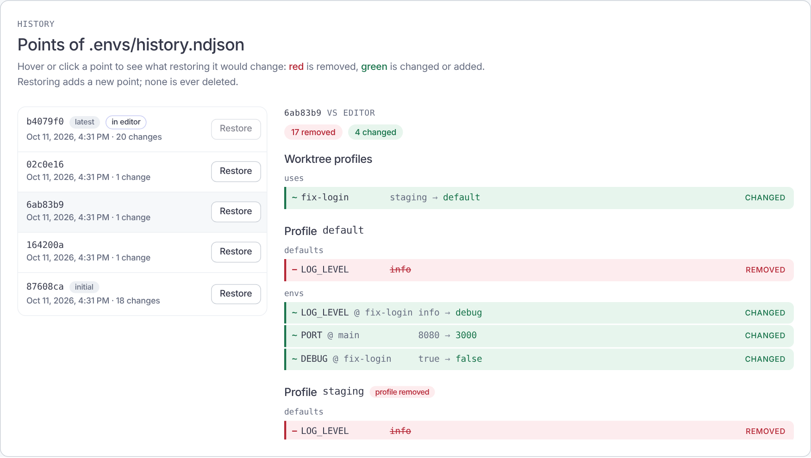

| Color | Significado |
| --- | --- |
| **Rojo** (`REMOVED`) | La propiedad existe ahora y desaparecería al restablecer ese punto. El valor actual aparece tachado. |
| **Verde** (`CHANGED`) | El valor cambiaría: `valor actual → valor del punto`. |
| **Verde** (`ADDED`) | La propiedad no existe ahora y aparecería. |

Los cambios se agrupan en *Worktree profiles* (`uses`) y por perfil, separando `defaults` y `envs`. Un perfil que existe solo de un lado lleva la etiqueta *profile removed* o *profile added*. Si no hay diferencias, el panel lo indica y el botón **Restore** de ese punto queda deshabilitado.

### 9. Fijar un punto con un clic

Un clic en un punto lo selecciona para que su diferencia siga visible al mover el cursor. **Hacer clic nunca restablece nada**; un segundo clic lo deselecciona.

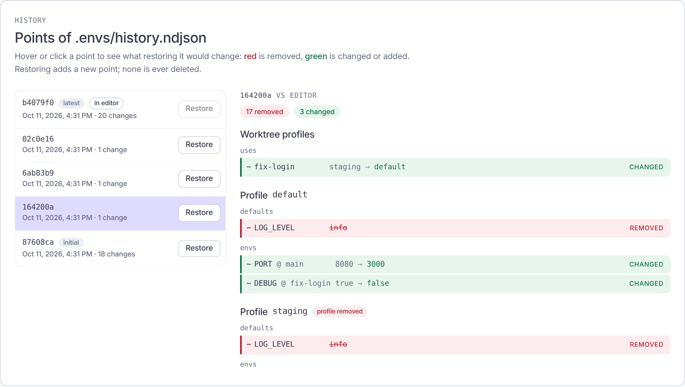

### 10. Restablecer un punto

El botón **Restore** de cada punto pide confirmación en la propia fila. Si hay cambios sin guardar en el editor, avisa que se perderán.

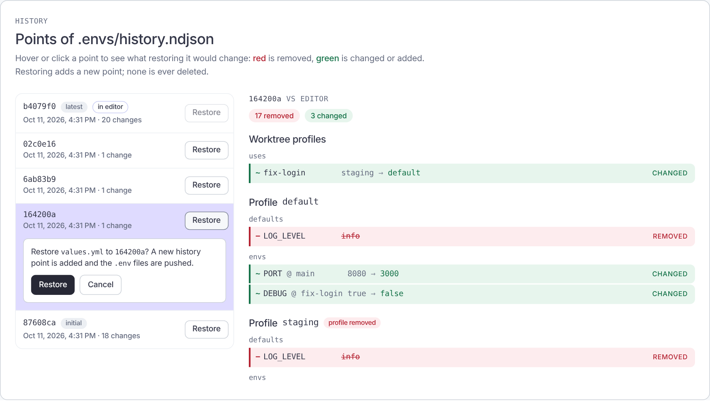

### 11. Resultado

Al confirmar, `values.yml` vuelve al estado de ese punto, se ejecuta `push` y se agrega un punto **nuevo** al final del historial. Ningún punto se borra. El encabezado muestra **Restored and pushed**.


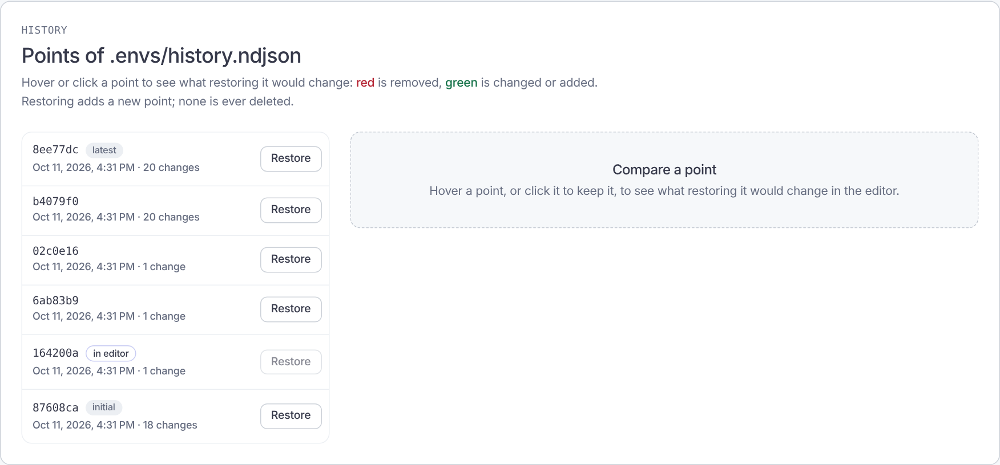

En el ejemplo, `8ed3d4a` pasó a ser el punto `in editor` y el nuevo punto `latest` registra el regreso.

### 12. Puntos externos

Un punto de [resincronización](history.md#puntos-de-resincronización) lleva la etiqueta **external**: registra cambios hechos fuera del historial, como una edición manual de `values.yml` o cambios con el historial desactivado. Pasa el cursor sobre la etiqueta para ver su descripción. Se comparan y se restablecen como cualquier otro punto.

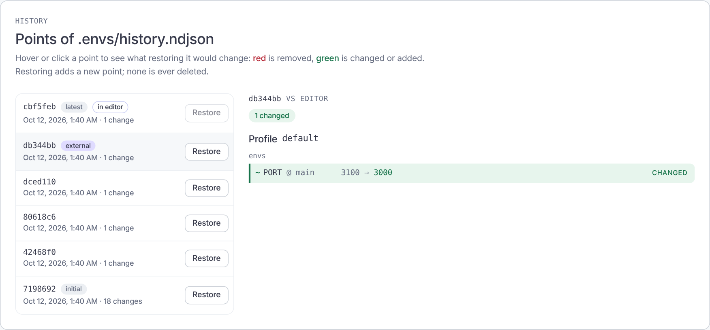

## Notas

- Con el historial desactivado (`envs config set history false`), el panel muestra un mensaje y no ofrece restablecer.
- El servidor solo escucha en `127.0.0.1` y expone `GET/PUT /api/values`, `GET /api/history` y `POST /api/restore`.
- Las capturas se generaron con Chromium (Playwright) sobre un proyecto de ejemplo; las fechas y hashes varían en cada ejecución.
